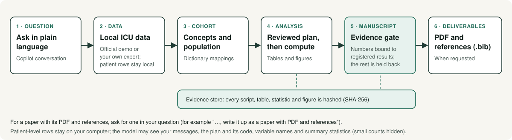
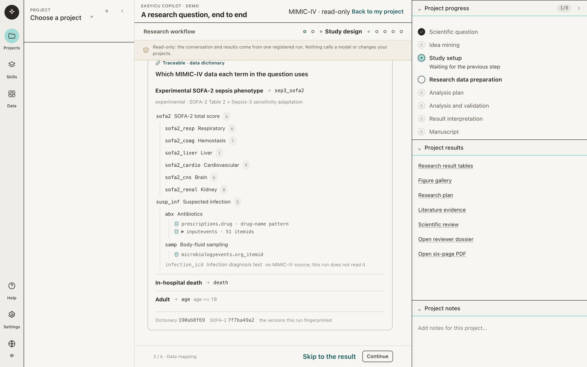
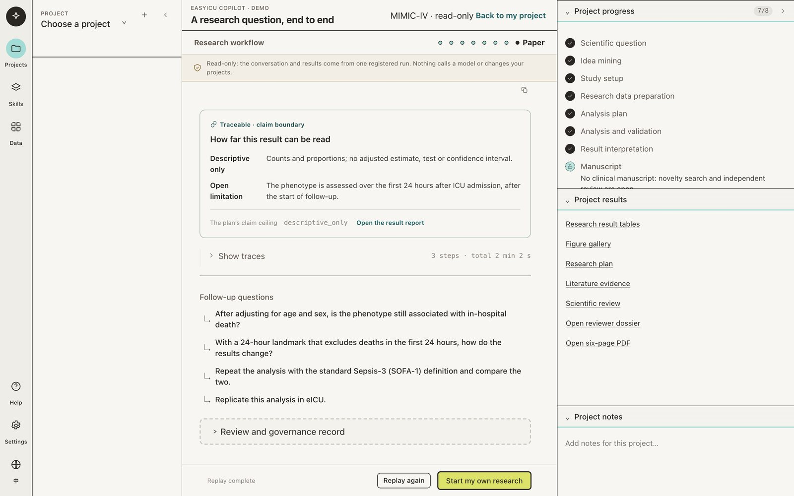
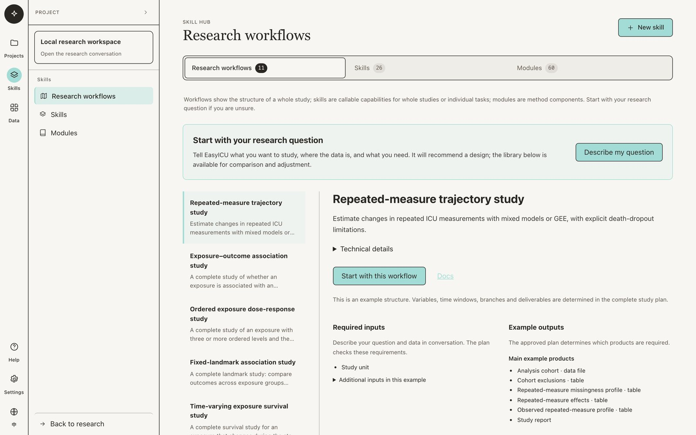
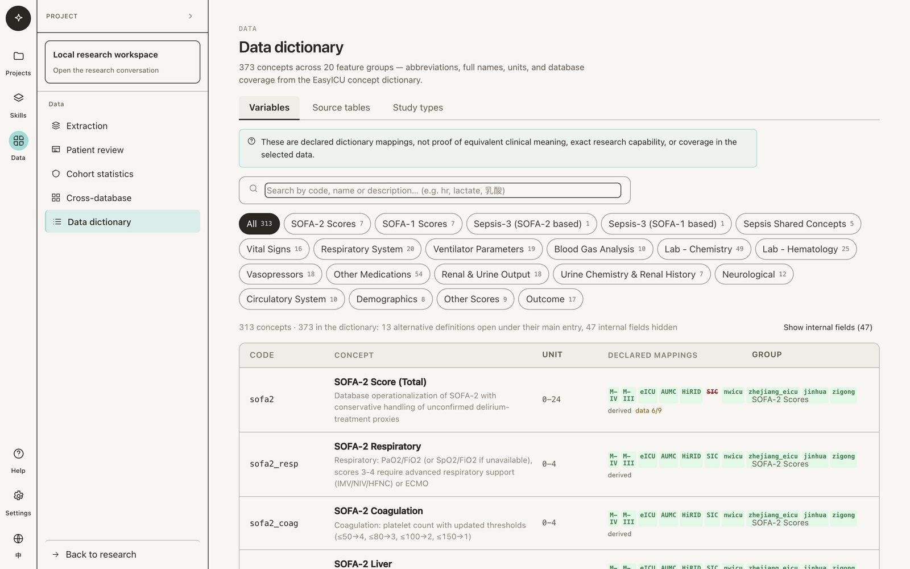

[**中文版 README**](README_zh.md)

# EasyICU

> A reproducible infrastructure for cross-database ICU research: standardized concept extraction, clinician-friendly web workflows, scriptable Python APIs, and an **evidence-bound research agent** that traces covered registered claims and holds back claims it cannot verify.

[](https://www.python.org/downloads/)
[](COPYING)
[](https://github.com/shen-lab-icu/easyicu)
[](src/easyicu/data/clinical-contracts.json)

[](https://github.com/shen-lab-icu/easyicu/releases/download/v0.1.3/easyicu-0.1.3-overview-en.mp4)

▶ [Watch the overview (English, 3:20)](https://github.com/shen-lab-icu/easyicu/releases/download/v0.1.3/easyicu-0.1.3-overview-en.mp4) · [中文版](https://github.com/shen-lab-icu/easyicu/releases/download/v0.1.3/easyicu-0.1.3-overview-zh.mp4). The values on screen in the video are schematic.

## What EasyICU does

You ask an ICU research question in plain language. EasyICU maps it to its
clinical concept dictionary, builds the study population from your local ICU
data, shows you the complete analysis plan to review, and then computes tables
and figures on your own computer. Every script, table, statistic and figure is
hashed into an evidence store; a manuscript reports only numbers that are bound
to a registered result, and anything it cannot verify is held back.



**Three ways to use it**

| | Use it when | Start |
|---|---|---|
| **Desktop app** | You want to click through a study without installing Python. Without Docker it gives first-round tables and figures; a paper needs Docker (see below). | Installers on the [releases page](https://github.com/shen-lab-icu/easyicu/releases); see the [installation guide](docs/installation.md). |
| **Web app from source** | You run EasyICU from a checkout in your local browser. | `./start_easyicu.sh` (or `start_easyicu.command` / `start_easyicu.bat`); see [Path A](#path-a-native-fastapi-web-interface). |
| **Python API and CLI** | You script extraction and analysis in code or notebooks. | Install from this repository or the release wheel, then `import easyicu`; see [Path B](#path-b-python-api). |

**Getting a paper.** If you want a manuscript with its PDF and references
(.bib), say so in your question, for example "…, write it up as a paper with
PDF and references". A paper needs the container runtime: Docker with the
EasyICU runner image, as in the web app from source or on a server. Without
Docker, 0.1.3 gives first-round tables and figures only, and the run says so.
In 0.1.3, "Extend to a full article" on a finished first result adds
paper-level analyses only; it does not write a manuscript.

The official public demo databases (MIMIC-IV, MIMIC-III and eICU demos from
PhysioNet) can be downloaded inside the app, so you can try every step before
connecting your own data.

**What stays local and what the model receives.** Extraction, review and
analysis run on your computer, and patient-level rows stay there. When model
calls are on, the configured model may receive your messages, the analysis plan
and its code, variable names, error details, and summary statistics with very
small counts hidden. The data tools block patient-level rows from model
requests; do not paste patient records into messages.

EasyICU is a Python toolkit for intensive care unit (ICU) data analysis. It provides unified access to the supported public ICU databases, automated extraction of hundreds of standardized clinical concepts, and a **web-based interface** for cohort definition, feature review, visualization, and export. Exact current counts are generated from the shipped registries in [the catalog summary](docs/catalog_summary.md), rather than copied into prose.

> **Clinical evidence status:** version `0.1.4` is a software/API release label,
> not a claim of database-specific clinical validation. The six full-concept
> database mappings currently remain `mapping_only`; independent clinical
> review and cross-database output-comparability validation are pending. The
> SOFA-2 implementation has algorithm-level golden and fail-closed boundary
> tests, which do not validate each database mapping. NWICU, Zhejiang eICU,
> CMAISE Jinhua ICU, and the Zigong infection cohort currently expose an
> audited core-concept subset only; SOFA/SOFA-2 conformance is `not_assessed`.

> **Respiratory source correction (2026-10-08):** MIMIC-IV and MIMIC-III `spo2`/`o2sat` no longer map the SpO2 alarm-limit item. New `peep_set`, `peep_total`, `fio2_chart`, and `fio2_lab` channels separate source definitions; legacy `peep`/`fio2` retain their mixed-source definitions. Existing exports are not rewritten. See the [source and synthetic-validation receipt](docs/validation/respiratory_source_channel_repair.md).

> **MAP channels and diuretics (2026-11-03):** `map` now uses the arterial-line value of an ICU hour when one exists and the cuff value otherwise, instead of pooling both; new `map_invasive` and `map_nibp` expose each channel, and MIMIC-III item 6702 (Arterial BP Mean #2) is mapped. `furosemide` covers every route, and new `loop_diuretic`, `thiazide_diuretic`, `potassium_sparing_diuretic`, `acetazolamide` and `loop_diuretic_furosemide_eq` (mg IV furosemide equivalent; Brater, N Engl J Med 1998) cover the diuretic classes. Existing exports are not rewritten.

An opt-in MIIV [scoped event extraction API](docs/validation/miiv_scoped_source_events_v2.md) now returns exact-stay hourly values, private raw-event lineage and source receipts. The legacy `load_concepts` interface remains unchanged.

## Why EasyICU

EasyICU has two layers that answer the two halves of one question — *how trustworthy is a reported ICU result?* The **concept layer** governs the clinical definition that produces a number; the **evidence-bound agent layer** governs the trail that records it.

- **One concept layer across ten registered public ICU sources**: six databases retain the established broad mappings and four community sources expose audited core subsets. The unit of cross-database analysis is the *concept* (`hr`, `crea`, `sofa2`…), not a database's private field name. Mapping coverage does not by itself establish database-specific clinical equivalence or cross-database comparability.
- **Reproducible from both code and UI**: the same prepared data can be used in the web app and in Python scripts or notebooks.
- **Evidence-bound, auditable analysis agent**: an optional research-agent layer turns a question + cohort into analysis where produced artefacts (script, log, table, statistic, figure) are hashed into a SHA-256 evidence store. For the structured artefact types and registered numeric claims covered by deterministic validators, mismatches are checked and unverifiable claims are **held back at the manuscript boundary** rather than published — a *fail-closed* design, not a general proof of arbitrary analysis code.
- **Cross-database replication for reliability**: the same research question can be re-run across databases as a replication protocol, so a conclusion's robustness can be *inspected* rather than assumed.
- **Tested on clinically meaningful use cases**: the framework includes an operational **SOFA-2** implementation with algorithm-level golden and negative tests. Database-specific SOFA-2 mappings remain `mapping_only` pending independent clinical validation.

## Who This Repository Is For

- **Reviewers and clinical researchers** who need to quickly understand what the project contributes and how it can support ICU research workflows.
- **Web users** who want to validate data, define cohorts, inspect features, and export results without writing code.
- **Python users** who want to build scripted, reproducible extraction and feature engineering pipelines.

## Start Here

[Installation guide](docs/installation.md) covers desktop builds, Python wheels, and source checkouts. Desktop installers include their runtime; the source launchers below require Python.

> **One rule before any API call:** every extraction API expects a **prepared (converted)** dataset, not a raw download. If you have never converted this database, run the **Convert step first** (Web UI *Validate Data Path → Convert & Setup*, or `DataConverter(...).convert_all()` — see [Python API](#-python-api)). `data_path` in every snippet below means *the prepared directory*.

### Quick Lookup: "I want to ... → run ..."

| Goal | Entry point |
|------|-------------|
| Validate data / define cohorts / export features without writing Python | **Native FastAPI Web app** — `easyicu-webapp` *(or `./start_easyicu.sh` / `start_easyicu.command`)* — see **Path A** |
| Build a reproducible extraction or feature pipeline in Python | **Python API** — `import easyicu` — see **Path B** |
| Extract features via CLI (scripted, no UI) | `easyicu extract --sources miiv --data-dirs /path/to/prepared/mimic-iv --output out/` (the `extract_features` console script; `easyicu --help` lists `extract`, `download`, `import`, `setup`, `copilot`) |
| Run the research-agent on a question + cohort | `easyicu-research-agent` |
| Reproduce an external paper through the agent | `easyicu-research-replication` |
| Host the LLM proxy used by the research-agent | `easyicu-llm-server` |
| Provide HTTPS login and per-user routing to hosted Unix-socket instances | `easyicu-hosted-gateway` (`easyicu[webapp]`; administrator-managed accounts and TLS configuration) |
| Install or refresh the optional Pi Copilot runtime bundled with the Web app | `easyicu-copilot-install` |
| Copy-paste runnable scripts | [`examples/`](examples/) — start with [`quickstart_convert_and_load.py`](examples/quickstart_convert_and_load.py) |

All console scripts are declared in `pyproject.toml` under `[project.scripts]` and become available once you install the package — see **[Path B](#path-b-python-api)** for the user vs. developer install options.

### Documentation Map

This README is the front door. Each major layer keeps a focused README next to its code:

| Read this | For |
|-----------|-----|
| [Product goals and design agreement](docs/EASYICU_PRODUCT_AGREEMENT.md) (Chinese) | Research-agent development intent, reliability and flexibility tradeoffs, acceptance evidence, and explicitly unresolved criteria. Read before changing priorities; this is a design agreement, not a claim of completed capabilities. |
| [`src/easyicu/README.md`](src/easyicu/README.md) | Package module map — concept abstraction, conversion, APIs, scores, Web, and Research Agent owners. Start here as a code contributor. |
| [`docs/native_fastapi_webserver.md`](docs/native_fastapi_webserver.md) | The maintained native FastAPI WebApp path and local route/API QA commands. |
| [`src/easyicu/research_agent/README.md`](src/easyicu/research_agent/README.md) | The evidence-bound research-agent layer: four-layer design, readiness gates, replication protocol. |
| [`src/easyicu/data/README.md`](src/easyicu/data/README.md) | The concept dictionaries (`concept-dict.json`, the SOFA-2 overlay) that drive cross-database extraction. |
| [`CONTRIBUTING.md`](CONTRIBUTING.md) | The expected workflow for proposing changes. |

### Path A: Native FastAPI Web Interface

Choose this path if you want to:
- launch EasyICU quickly
- validate and prepare data visually
- define cohorts and export features without writing Python

> **Requirements**
> - Python 3.11–3.12 and at least 4 CPU cores.
> - Memory for a full-cohort extraction: 16 GB RAM recommended for MIMIC-IV-scale databases (about 66–70 minutes on 4 cores; 14 GB also completes after one automatic retry). eICU needs a high-memory server (about 88 GiB peak with 4 workers).
> - Peak memory per database, measured data and the full table: [docs/local_run_guide.md](docs/local_run_guide.md#memory--内存).

Recommended entry:
- Double-click `start_easyicu.bat` on Windows
- Double-click `start_easyicu.command` on macOS
- Run `./start_easyicu.sh` on Linux

First launch will create a local runtime under `.easyicu-runtime/` and
install the web dependencies automatically. Use Python 3.11–3.12 for this
path.

Default local URL:

```text
http://127.0.0.1:8765
```

The native Web app is intentionally **loopback-only** because it exposes local
filesystem and job APIs. Bind requests such as `--host 0.0.0.0` are rejected;
use a local browser or an authenticated tunnel instead of exposing it directly.

### Path B: Python API

Choose this path if you want to:
- call EasyICU from scripts or notebooks
- automate feature extraction
- build reproducible cohort pipelines in code

EasyICU is tested on Python 3.11 and 3.12 (`requires-python = ">=3.11"` is the package floor; 3.13 is not yet tested in CI).

**Install it to use it** (no clone needed):

```bash
pip install "easyicu[webapp] @ git+https://github.com/shen-lab-icu/easyicu.git"
```

Swap the extra in brackets for what you actually need:

| You want to… | Install |
|--------------|---------|
| Python API — extract concepts, SOFA / SOFA-2, sepsis-3, scores | `easyicu` |
| Native FastAPI web app (+ dormant-by-default provider status tooling) | `easyicu[webapp]` |
| Plotly / Kaleido figure export | `easyicu[viz]` |
| Host the LLM proxy for the research-agent | `easyicu[llmserver]` |
| Research-agent HTTP/PDF/image helpers | `easyicu[agentic]` |
| Official MCP SDK server transports | `easyicu[mcp]` |
| Every extra, including `dev`, `cli`, `methods` and `scientific-adapters` | `easyicu[all]` |

`easyicu[all]` includes `easyicu[scientific-adapters]`. Those optional
causal/survival validation adapters do not acquire scientific authority merely
by being installed.

The **core install (`easyicu`) already bundles the research-agent's analytical
stack** (`scikit-learn`, `statsmodels`), so the Python API and the deterministic
agent path work out of the box. The research-agent CLI additionally needs an LLM
client — install `easyicu[webapp]` (bundles `openai`) or run `easyicu-llm-server`.

`easyicu-llm-server` is a credential-bearing relay and therefore fails closed:
it binds to `127.0.0.1` by default and requires
`EASYICU_HOSTED_SERVER_TOKEN`. Browser origins and any direct upstream model
names must be explicitly allowlisted. Unauthenticated development mode is
available only through the explicit local-only opt-in documented by
`easyicu.hosted_llm_server` and must never be used for a remote bind.

**Install it to develop it** (editable clone):

```bash
git clone "https://github.com/shen-lab-icu/easyicu.git"
cd easyicu
python -m venv .venv
source .venv/bin/activate   # Windows: .venv\Scripts\activate
python -m pip install --upgrade pip
pip install -e ".[all]"
```

Launch the native Web app manually if needed:

```bash
easyicu-webapp
```

The legacy Streamlit package has been removed from the active package boundary.
If archive forensics require it, restore it from git history before Stage27 or
from the local Stage27 archive patch.

## Reproducibility & Safety

- **Prepared data is the shared contract**: raw CSV / CSV.GZ / tar.gz dumps should be converted first, then reused by both the web interface and Python APIs.
- **AI assistant is opt-in**: the assistant starts disabled until a user explicitly enables it in the sidebar.
- **Human confirmation stays in the loop**: cohort, feature, conversion, and export actions still require explicit confirmation.
- **Automated checks are included**: `pytest` and GitHub Actions provide baseline repository checks for the packaged workflows. The maintained Web UI test gate is the native FastAPI path.

## Paper, Citation & Reproducibility

- **Software citation**: GitHub citation metadata is provided in [CITATION.cff](CITATION.cff).
- **Repository entry point for reviewers**: this README is structured to show the project contribution, supported databases, and the shortest reproducible usage paths first.
- **Reproducible execution paths**: use the one-click launcher for the web workflow, or use the Python API examples below after running data preparation.
- **Manuscript link**: add the journal article or preprint URL here once it is public.

## Supported Public ICU Databases

| Database | URL |
|----------|-----|
| MIMIC-III | https://physionet.org/content/mimiciii/ |
| MIMIC-IV | https://physionet.org/content/mimiciv/ |
| eICU-CRD | https://physionet.org/content/eicu-crd/ |
| AmsterdamUMCdb | https://amsterdammedicaldatascience.nl/ |
| HiRID | https://hirid.intensivecare.ai/ |
| SICdb | https://physionet.org/content/sicdb/ |
| NWICU | Local credentialed PhysioNet release (0.1.0) |
| Zhejiang eICU | OMIX005817 |
| CMAISE Jinhua ICU | OMIX007493-02 |
| Zigong ICU Infection Cohort | PhysioNet 1.1; infection-enriched cohort |

The four community sources support raw ZIP/nested-CSV conversion, identity
detection, stay indexing, and audited demographic, outcome, vital-sign, and
selected laboratory mappings. Unmapped concepts remain explicitly unavailable.
Zhejiang uses an encounter-level stay proxy, Jinhua collapses multiple ICU
episodes within an admission, and Zigong is not an unselected general-ICU
population. Their deidentified time offsets are normalized explicitly from
days (Zhejiang), minutes (Jinhua), or hours (Zigong) to ICU-relative hours.
These limits are written to the local
`community_preparation_manifest.json` receipt.

## Web Workflow At A Glance

1. **Pick a data source.** Download an official public demo database inside
   the app, or point EasyICU at your own local ICU export.
2. **Ask your question** in the Guided Copilot conversation. Copilot maps it
   to dictionary concepts and the study population.
3. **Review the complete plan** (population, variables, methods) and approve it.
4. **Read the result** on the run card: tables, figures, and how far the result
   can be read. Ask for a paper up front if you want a manuscript, PDF and .bib.

The first two screenshots come from the built-in read-only demo, which replays
one registered MIMIC-IV run without calling a model.

### Copilot Conversation

Copilot shows what it is doing at each step, here mapping the question's
variables to the selected data source before the plan is prepared.



### Result And Its Reading Boundary

Each result says what the run computed and how far it can be read, here
descriptive only: counts and proportions, with no adjusted estimate, test or
confidence interval.



### Skill Hub

The Skill Hub lists research workflows, skills and method modules. Each workflow
shows the inputs it needs and the outputs an approved plan can produce.



### Data Dictionary

The data dictionary lists each clinical concept with its definition, unit and
declared mapping per database. A declared mapping is not proof of equivalent
clinical meaning in your data.



### Cross-Database Benchmark

The **Cross-DB Benchmark** tab harmonizes a clinical concept across registered
databases that actually declare a mapping for it and overlays their
distributions for direct comparison. "Benchmark" here is an exploratory
comparison and quality-check view in the web interface; it is not a formal
model leaderboard or an external benchmark result.

### Data Preparation

EasyICU validates raw database directories and prepares them for extraction. It
detects raw layouts such as CSV / CSV.GZ / tar.gz, converts them to Parquet,
applies database-specific optimizations, and prepares the structure used by both
the web interface and the Python APIs.

## Visualization & Analysis

Start a research workflow in **Guided Copilot** with a question and a selected
data source, and review the complete prepared plan before execution. The run
card in the conversation shows status, files and evidence. The extraction
workspace also offers patient review, time series, cohort statistics and
cross-database comparison for expert direct entry. These views share the same
prepared data and scientific execution owners.

The Research Agent layer turns a question plus prepared EasyICU data into an
evidence-bound research output (**Plan → Build → Analyze → Gate**) and drafts a
manuscript only when one is requested and the evidence gate passes.

## Evidence-Bound Research-Agent Layer

`easyicu.research_agent` is an optional layer that turns a research
question + a confirmed cohort export into an **auditable** analysis. It
is not required for the standard web workflow or Python extraction APIs.
See [src/easyicu/research_agent/README.md](src/easyicu/research_agent/README.md)
for the full design.

**Why it is more than orchestration.** Generic analysis agents are
strong at planning and code generation but weak on ICU semantics — they
average ordinal SOFA components, silently impute missing PaO₂, skip
component-completeness checks on composite scores, and confuse ICU with
hospital mortality. EasyICU closes that gap with four layers:

1. **ICU Data Foundation** — the concept dictionary above, reused as the
   agent's prompt-level view of the data (raw rows are not placed in the
   prompt; catalog and deterministic validators constrain variable use).
2. **Safe Analytical Runtime** — a SHA-256 `EvidenceStore`, a numeric
   claim registry, deterministic validators, and execution replay.
3. **Agent Orchestration** — planner / replanner / coder / analyzer /
   writer / critic, with deterministic gates between every LLM step.
4. **Candidate Hypothesis Ranking** — a bounded, human-curated pre-plan
   stage (not an autonomous "scientific discovery" system).

**Fail-closed, not free-running.** A `ResearchContext` carries each
variable's role, units, allowed aggregations, time windows, missingness
semantics and ICU pitfalls into the agent loop *and* into the
validators. Pipeline artefacts are hashed into the evidence store; numeric
claims that enter the registered claim pathway are re-checked against their
source. Four readiness gates — **execution-complete /
evidence-complete / numeric-verified / analysis-validated** — are
computed mechanically (anyone can recompute the same label) and sort the
output into three states: **gate-reportable**, **analysis-only**, or
**diagnostic-only**. An unverifiable claim (e.g. a draft `AUROC 0.8`
that does not match the registered `0.842`) is intercepted at the
manuscript boundary and routed for repair, code re-run, or human review
— it must pass the same gates again before it can enter a reportable
manuscript.

**Cross-database replication for reliability.** Cross-database work
defaults to a replication protocol: the same question is re-run on other
supported databases (`cross_database_validation=["eicu", "hirid"]`) so a
conclusion's robustness across case-mix, coverage and missingness can be
inspected — not to claim one database is "better".

**Deterministic auditing, not LLM-as-judge.** The hard checks
(`concept_usage`, statistical, causal, reporting-checklist, multiple
testing, fairness) are deterministic and rule-based, so the system does
not rely on one LLM grading another. The historical `icu_agent_bench`
module is an **internal evaluation protocol**, not a frozen public
benchmark, and should be described that way.

## 🚀 Going Further (Developers / Advanced Users)

### Development & Testing

Create a local development environment and run the current automated checks:

Use Python 3.11–3.12 for the development environment.

```bash
python -m venv .venv
source .venv/bin/activate   # Windows: .venv\Scripts\activate
python -m pip install --upgrade pip
pip install -e ".[dev,webapp]"
pytest -q
```

Pull requests run the Linux/Python 3.11 checkpoint. The exhaustive Python/OS matrix is manually dispatched for a declared final candidate; pushes to main do not start it. Local `pytest -q` uses the development marker filter. See [CONTRIBUTING.md](CONTRIBUTING.md) for the expected workflow when proposing changes.

## 💻 Python API

Before calling any extraction API, make sure your database has already been prepared.
Raw CSV / CSV.GZ / tar.gz dumps are not the expected input for feature extraction APIs.
Use either the Web UI **Validate Data Path** -> **Convert & Setup** flow or the programmatic conversion step below first, then pass the prepared directory to `data_path`.

### API Prerequisite: Convert Data First

The web application can prepare the data for you automatically. You can also convert it in code:

```python
from easyicu import DataConverter

converter = DataConverter('/path/to/raw/data', database='miiv')
converter.convert_all()
```

After conversion, use the prepared directory in all API examples below.

> **Tip — slow external storage (USB / network mounts)**: the default
> `parallel_workers=4` is tuned for local SSD and can deadlock on slow
> external storage during large sharded writes (PRESCRIPTIONS, CHARTEVENTS).
> Set `EASYICU_CONV_WORKERS=1` to force single-threaded conversion:
> ```bash
> EASYICU_CONV_WORKERS=1 python convert_my_data.py
> ```
> On a 90 GB AUMC numericitems on USB this trades ~30 % wall-clock for
> guaranteed completion.

### Minimal End-to-End Example

`data_path` always points at the converted/prepared directory. If you only have a raw download, run the converter (`DataConverter(...).convert_all()` or the Web UI **Convert & Setup**) first.

The example below shows the full workflow for API users: start from raw data, convert it, then extract standardized features.

```python
from easyicu import DataConverter
from easyicu import load_concepts

database = 'miiv'
raw_data_path = '/path/to/mimic-iv-raw'

# Step 1: Convert raw files into the prepared format expected by EasyICU
converter = DataConverter(raw_data_path, database=database)
converter.convert_all()

# Step 2: Extract standardized concepts from the prepared dataset
vitals = load_concepts(
    concepts=['hr', 'map', 'resp', 'spo2'],
    database=database,
    data_path=raw_data_path,
    patient_ids=[30000123, 30000456],
    interval='1h',
    aggregate='mean',
)

print(vitals.head())

# Optional: save the extracted feature table
vitals.to_parquet('miiv_vitals_1h.parquet', index=False)
```

What this example assumes:
- `raw_data_path` points to your original downloaded database directory
- conversion prepares that same directory for EasyICU loading
- after conversion, pass the prepared directory to `data_path`

### Easy API — One-Liners

> ⚠️ `data_path` below must point to a **converted/prepared** directory (see [Convert Data First](#api-prerequisite-convert-data-first)). Passing a raw download here will fail.

```python
from easyicu import load_sofa, load_sofa2, load_vitals, load_labs

# Load SOFA scores
sofa = load_sofa(
    database='miiv',
    data_path='/path/to/mimic-iv',
    patient_ids=[30000123, 30000456]
)

# Load SOFA-2 (2025 revised criteria)
sofa2 = load_sofa2(
    database='miiv',
    data_path='/path/to/mimic-iv',
    patient_ids=[30000123],
    keep_components=True  # retain organ sub-scores
)

# Load vital signs
vitals = load_vitals(database='miiv', data_path='/path/to/data')

# Load laboratory results
labs = load_labs(database='miiv', data_path='/path/to/data')
```

### Concept API — Flexible & Customizable

> ⚠️ `data_path` below must point to a **converted/prepared** directory (see [Convert Data First](#api-prerequisite-convert-data-first)).

```python
from easyicu import load_concepts

# Batch-load multiple concepts
data = load_concepts(
    concepts=['hr', 'sbp', 'dbp', 'temp', 'resp', 'spo2'],
    database='miiv',
    data_path='/path/to/mimic-iv',
    patient_ids=[30000123],
    interval='1h',       # align to 1-hour bins
    aggregate='mean',    # aggregate with mean
    verbose=True
)

# Load Sepsis-3 diagnosis
sepsis = load_concepts(
    'sep3',
    database='miiv',
    data_path='/path/to/data'
)

# Special concepts — KDIGO AKI staging and circulatory failure are
# computed by dedicated callbacks, but you can request them through the
# same `load_concepts(...)` call. The API will route to the right
# loader transparently.
aki_and_circ = load_concepts(
    concepts=['aki', 'aki_stage', 'aki_stage_creat', 'aki_stage_uo',
              'aki_stage_rrt', 'aki_severe', 'aki_severe_creat',
              'aki_severe_uo', 'aki_severe_rrt',
              'aki_severe_assessable', 'aki_severe_ascertainment',
              'aki_assessable', 'aki_ascertainment',
              'observation_window_coverage',
              'uo_rt_6hr', 'uo_rt_12hr', 'uo_rt_24hr',
              'creat_low_past_48hr', 'creat_low_past_7day',
              'circ_failure', 'circ_event'],
    database='miiv',
    data_path='/path/to/data',
)

# Whole-DB / module-style batch extraction (fastest path)
# Pass the full list of concepts in one call so the resolver can share
# base-table reads (chartevents / labevents / inputevents bucket scans)
# across all of them. `merge=False` returns a `dict[concept -> DataFrame]`
# so the result stays small even on huge cohorts.
all_features = load_concepts(
    concepts=['hr', 'sbp', 'map', 'temp', 'spo2',
              'bili', 'crea', 'lact', 'plt', 'wbc',
              'sofa', 'sofa2', 'sep3',
              'aki', 'circ_failure'],
    database='miiv',
    data_path='/path/to/data',
    merge=False,           # return dict instead of one giant merged DataFrame
)
```

`aki_stage == 0` is a definitive absence of AKI only when
`aki_ascertainment == 'negative_complete'`; rows with partial or indeterminate
ascertainment must not be used as non-AKI controls.
Likewise, `aki_severe` is a nullable KDIGO stage 2-3 state, not an incident
endpoint. Define incident severe AKI downstream from an explicit baseline and
follow-up anchor; use the component outputs when full three-component
ascertainment is unavailable.

> **Note on full-cohort extraction**: when you don't pass `patient_ids`
> and `max_patients`, EasyICU loads every patient in the database. On a
> 16 GB machine with limited free memory, `load_concepts(...)` may
> auto-batch into subprocess workers — set the environment variable
> `EASYICU_BATCH_TIMEOUT_SEC` (default 3600) to bound each batch in
> case a worker hangs.
> For disk exports, `extract_database(..., stream_output_batches=True)`
> additionally chooses its default batch from **currently available** memory,
> not nominal RAM. It reserves 25% (at least 2 GiB), combines a continuous
> capacity estimate with conservative full-six release measurements, and then
> resizes every module's later batches from its first measured process-tree
> working set (up to 67k stays). This is not a fixed 10k low-memory tier: with
> 8 GiB available the current initial pilots are approximately 20k for
> MIMIC-III, 37k for MIMIC-IV, 25k for eICU, and 5k for the unusually dense
> AUMC source. Below 24 GiB, MIMIC-III, MIMIC-IV and AUMC must provide a
> measured pilot before one-shot execution is admitted; lower-risk calibrated
> cohorts remain one-shot when their conservative peak fits the reserved
> budget. When that high-risk guard alone requires a split, it starts from an
> even half rather than creating a tiny residual batch. This guard follows the
> 2026-08-03 observations that MIMIC-III one-shot reached about 16.83 GiB,
> AUMC one-shot reached about 29.31 GiB, and a 67k eICU `other_scores` batch
> reached about 15.6 GiB. Module/batch peak-RSS telemetry is written to the
> manifests, and Sepsis derivation reuses the same outer batch instead of a
> hidden 2k sub-batch. Explicit `batch_size` values remain authoritative.
>
> **Unfinished exports are refused.** While `extract_database` or a web export runs, the export
> folder holds an `_IN_PROGRESS` marker and raw, unpublished module files; the
> marker is removed only after the root `_manifest.json` is written. EasyICU
> readers refuse a folder with the marker, or without `_manifest.json`
> (`native_export_unpublished`). A new extraction into a folder that still
> holds the marker of an interrupted run is refused, and nothing in it is
> deleted: choose a new output folder, or move that one aside after checking it.

### Domain-Specific Loaders

> ⚠️ `data_path` below must point to a **converted/prepared** directory (see [Convert Data First](#api-prerequisite-convert-data-first)).

```python
from easyicu import (
    load_demographics,      # Demographics
    load_outcomes,          # Clinical outcomes
    load_vitals_detailed,   # Detailed vital signs
    load_neurological,      # Neurological assessments
    load_output,            # Fluid output
    load_respiratory,       # Respiratory parameters
    load_lab_comprehensive, # Comprehensive lab panels
    load_blood_gas,         # Arterial blood gas
    load_hematology,        # Hematology
    load_medications,       # Medications
)

# Example: load demographics
demo = load_demographics(
    database='miiv',
    data_path='/path/to/data',
    patient_ids=[30000123]
)
```

---

## 📄 License

The combined EasyICU distribution is licensed under **GPL-3.0-only** because
its clinical configuration includes modified material from the GPL-3-licensed
[ricu](https://github.com/eth-mds/ricu) project. See [LICENSE](LICENSE), the
complete terms in [COPYING](COPYING), and the attribution and change notice in
[THIRD_PARTY_NOTICES.md](THIRD_PARTY_NOTICES.md). EasyICU-authored material
also retains its original MIT permission in [LICENSES/MIT.txt](LICENSES/MIT.txt).

---

<div align="center">

**⭐ If EasyICU is helpful for your research, please give us a Star! ⭐**

Made with ❤️ for ICU researchers worldwide

</div>
